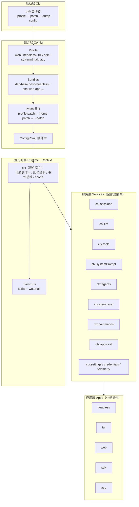

# 01 · 架构设计

> 参照对象：`deepseek-ai/deepseek-harness`（`dsh`）。本文描述 `ts-dsh` 的架构，并在第 10 节给出与上游的逐项映射。

## 1. 目标与边界

`dsh` 的定义是一句话：**Agent = Model + Harness**。模型是"大脑"，Harness 是"身体"——工具、权限、会话记忆、以及让 Agent 持续工作下去的那个循环。本项目的目标是复刻这个**身体**的骨架，而不是做一个能聊天的 CLI。

**做什么**：插件宿主、分层配置、会话事件日志、模型适配器接缝、工具执行流水线、turn/step 主循环、多形态应用入口、CLI 启动器。

**不做什么**（明确边界）：Electron 桌面端、浏览器 Web 客户端工程、Cordis 完整 DI 实现、MCP/子 Agent/团队/调度器/沙箱后端、真实模型调用的教学演示数据。这些是上游的规模所在，不在本复刻范围内。

## 2. 总体架构



一句话读图：**CLI 把分层配置组合成一棵 `ConfigRow[]`，逐行 mount 成 `ctx` 上的服务，最后从 `ctx` 取出 app 插件并运行**。没有任何一行代码是"特权核心"。

## 3. 第一原则：Everything is a Plugin

上游架构文档原文：*"There is no privileged core to patch: you extend dsh by mounting a plugin beside the others, and registrations are effects that unwind when their plugin unloads."*

落到本项目：

- 每个能力（连 `agentLoop` 自己）都是一个 `PluginFactory = (ctx, config) => void | Disposable`。
- 插件通过 `ctx.provide('tools', new ToolRegistry(...))` 把自己的服务挂到 `ctx.<key>`；别的插件只依赖 `ctx.get('tools')`，不 import 具体实现。
- 插件注册的工具、事件监听、服务都是**可逆副作用**：`ctx.onDispose()` 记录回滚函数，插件 `unmount` 时按逆序执行（对应 Cordis 的 temporal composability）。
- 服务可被 `ctx.waitFor(key)` 等待；服务出现/消失时发出 `service/*` 通知（对应 spatial composability 的简化版）。要替换某个能力，改配置行即可，无需改其他插件。

## 4. Context、Service、Effect

```
Context
 ├─ provide(key, value) -> Disposable      # 注册服务，返回可逆句柄
 ├─ get<T>(key) / peek<T>(key)             # 取服务（缺失即抛 / 返回 undefined）
 ├─ waitFor<T>(key): Promise<T>            # 等依赖就绪
 ├─ onService(key, cb) -> Disposable       # 服务 added / removed 通知
 ├─ onDispose(fn) -> Disposable            # 登记可逆副作用
 ├─ scoped(scopeKey): Context              # 派生作用域上下文
 └─ dispose()                              # 逆序回滚全部副作用
```

**作用域（scope）**：一次注册要么是 global（所有 agent 可见），要么 scoped（只属于一个 scope key）。名字解析采用**最具体者胜（shadowing）**——scoped 工具覆盖同名 global 工具；`tools.restrict()` 先对 global 集合做交集过滤，再合并 scope-local 注册。这是上游"per-agent persona / per-agent tool-variant"机制的简化实现。

## 5. Profile / Bundle / Patch：分层组合

上游：*"A running dsh is a plugin tree composed at boot from ordered layers."*

```
结果 = []
for bundle in profile.bundles:          # 1. 有序 bundle
    应用 bundle.rows（按 id insert-or-replace）
apply(profile.patch)                     # 2. profile 自带 patch
apply(homePatch)                         # 3. 用户 home patch
for p in --patch: apply(p)               # 4. CLI 覆盖层（最高优先级）
```

- **Bundle**：分发格式，携带一批 `ConfigRow` 及其代码。
- **Profile**：命名组合，列出有序 bundle 列表、外挂插件与自己的 patch。
- **Patch**：`replace(id, row)` / `insert(row, before|after)` / `remove(id)`，按 id 定位并整体替换配置（不做深合并，与上游一致）。
- `--dump-config` 打印最终树；`--dump-default-config` 跳过用户层与 `--patch`。

`dsh-base` 是 `web / headless / tui / sdk / acp` 共享的第一层（模型、工具、持久化、审批、设置、凭据、遥测）；`dsh-sdk-minimal` 是刻意例外——一个 bundle 拥有完整的显式 SDK 树，不叠加 base。

## 6. 能力接缝（Capability Seam）

上游定义：一个 seam 是**可替换能力**的三角色组合——Service Definition（声明接口与 `ctx.<key>`）、Service Provider（实现）、Consumer（使用，常是模型侧工具）。

本项目的典型接缝：

| Seam | Definition/Registry | Provider | Consumer |
| --- | --- | --- | --- |
| 模型 | `ctx.llm` 适配器注册表 | `llm/deepseek`、`llm/mock` | `agentLoop` |
| 工具 | `ctx.tools` 注册表 | `tools/builtin` | `agentLoop`、prompt 装配 |
| 审批 | `ctx.approval` | `approval/presets` | 工具执行流水线 |
| 文件系统 | `ctx.fs`（简化） | `fs/local` | `read_file` / `write_file` |

要点：**换一个 provider 就换了整个产品的行为**，消费方不需要分支判断。

## 7. 事件域

上游把扩展点分成三域，本项目一一对应：

| 域 | 例子 | 是否落盘 |
| --- | --- | --- |
| **Session events**（持久事实） | `turn/start`、`step/start`、`system/message`、`user/message`、`assistant/message`、`assistant/attempt`、`tool/call`、`tool/result`、`request/header`、`turn/end` | ✅ append-only 日志 |
| **Agent events**（在途工作，live） | `agent/created`、`agent/pre-step`、`agent/request`、`agent/assistant-stream`、`agent/turn-stopping` | ❌ 进程内 |
| **Capability events**（策略/适配） | `tools/pre-execute`、`tools/execute`、`tools/post-execute`、`service/*` | ❌ 进程内 |

分发语义：`serial`（依次执行，无 `next()`）、`waterfall`（监听者必须 `next()` 委托，可改写载荷）。`agent/turn-stopping` 是 serial 且无 `next()`。

## 8. Turn / Step 流程

上游：*"A step is one model request plus the tools it calls. A turn is zero or more steps."*

```text
turn/start
  append user/message
  loop (step < maxSteps):
    step/start
    snapshot 模型选择；组装 system prompt + 本 step 准入的工具 schema
    agent/pre-step（waterfall：accept / rewrite / reject）
    agent/request（waterfall：可改写请求）
    llm/stream：流式收集 → assistant/message（含 tool_calls）
    if tool_calls:
        tool/call* → tools/pre-execute → approval → tools/execute
                   → tools/post-execute → tool/result*
    step/end
    if 无 tool_calls: break
  agent/turn-stopping（serial）
turn/end
```

- **失败/取消/重试**记为 `assistant/attempt`，不进入模型历史。
- 请求一旦发出即不可变；取消发生在 `prepareCall` 之前则 system 与 user 都不提交。
- `deriveMessages()` 从日志投影出模型可见历史：**Model-visible means logged**。

## 9. Session 日志是唯一真相源

- 存储：每个会话一个目录，JSONL 物理帧（本复刻为 `session.v1.jsonl`），append-only，代际文件只新增不改名/不删除。
- 投影：`system/message → system`，`user/message → user`，`assistant/message → assistant(+tool_calls)`，`tool/result → tool`。
- 派生：fork / resume / transcript / search / stat / list 全部从日志重放，不另存第二份状态。
- 容错：读取时容忍被截断的尾行（未提交的中断尾部由消费者负责）。
- live UI 的增量来自 `agent/assistant-stream` 这类进程内事件，与持久结算分离。

## 10. 与上游的映射与取舍

| 上游 | 本项目 | 说明 |
| --- | --- | --- |
| Cordis 插件系统 / 时空可组合 | `Context` + 可逆副作用 + `waitFor` | 保留语义，去掉完整 DI 实现 |
| `cordis.patch.yml` | `cordis.patch.json` | 零依赖，避免引入 YAML 解析器（见 05 技术选型） |
| `packages/*`（40+ 包，pnpm monorepo） | `src/{core,config,session,llm,tools,agent,commands,apps,profiles}/*` | 单包，逻辑分层不丢 |
| Web UI / Electron Desktop | 内置 HTTP 服务 + 极简静态页 | 保留 web 运行形态，去掉客户端工程 |
| Core packages：`core/session`、`core/tools`、`core/agent-loop`、`llm/llm` | 同名模块 + `ctx.<key>` | 一一对应 |
| `dsh --profile headless "task"` / `--json` / `--session-id` | 同款 CLI 参数 | 保持可辨识度 |
| 子 Agent / 团队 / 调度 / MCP / 沙箱后端 | 不实现 | 明确边界，见第 1 节 |
| 真实 DeepSeek API | 支持，且无 Key 自动回退 Mock | 保证离线与 CI 可运行 |

**刻意保留的"神似"**：插件树可 dump、能力可替换、事实全落盘、turn/step 边界清晰、profile 分层有序。**刻意简化的"形"**：单包、JSON 配置、零运行时依赖、无浏览器客户端。

## 11. 质量属性

- **可替换性**：任何服务都能被一行 patch 换掉，消费方零改动。
- **可回溯性**：所有模型可见输入都在日志里，可从日志完整重建请求。
- **可测试性**：核心域（组合、投影、SSE 解析、流水线、主循环）不依赖网络与真实模型，Mock 适配器让 CI 全离线。
- **可逆性**：插件卸载后不留残留注册（对应"移除插件即移除它注册的一切"）。
