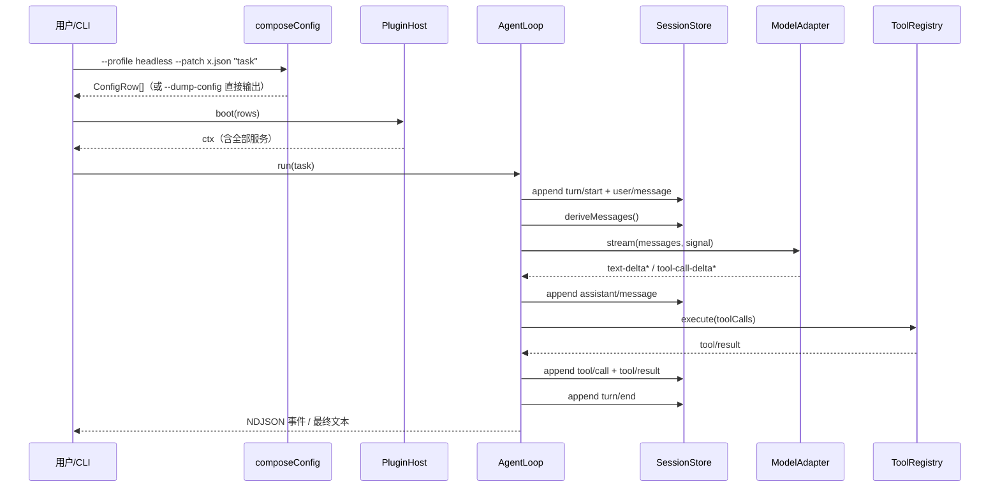

# 03 · 概要设计

> 本文把 `01-architecture.md` 的原则落到模块、接口、算法与数据流，是编码前的最后一张蓝图。

## 1. 模块划分与目录

```
src/
  cli.ts                     # dsh 启动器：参数解析 → 组合配置 → 挂载 → 运行 app
  version.ts                 # 版本号常量
  core/
    context.ts               # Context 插件宿主、可逆副作用、服务注册、scope
    events.ts                # EventBus：serial / waterfall
    plugin.ts                # PluginFactory / PluginHost（mount / unmount / boot）
    scope.ts                 # ScopeKey 与影子解析
    errors.ts                # DshError 及错误码
  config/
    types.ts                 # ConfigRow / PatchOp / Patch / Bundle / Profile
    compose.ts               # composeConfig() 分层叠加 + dump
    schema.ts                # dump-config-schema 的 JSON Schema
    loader.ts                # 读 home patch / --patch 文件（JSON）
  profiles/
    bundles.ts               # 7 个内置 bundle 的 ConfigRow[]
    index.ts                 # 6 个内置 profile 模板 + plugin 工厂注册表
  session/
    types.ts                 # SessionEvent 联合类型、SessionHeader
    jsonl.ts                 # JSONL 物理帧：append / read / 代际
    store.ts                 # SessionStore：create/open/append/replay/fork/resume/search
    projection.ts            # deriveMessages() 模型历史投影
  llm/
    types.ts                 # Message / StreamChunk / StreamRequest / ModelAdapter
    registry.ts              # LlmRegistry（ctx.llm）
    sse.ts                   # SSE 帧解析 + tool_call delta 聚合
    deepseek.ts              # DeepSeek OpenAI 兼容流式适配器
    mock.ts                  # 确定性 Mock 适配器
  tools/
    types.ts                 # Tool / ToolResult / ExecuteOptions
    registry.ts              # ToolRegistry（ctx.tools）+ 执行流水线
    approval.ts              # ApprovalPolicy（ctx.approval）+ 权限预设
    builtin.ts               # 6 个内置工具
  prompt/
    assembler.ts             # SystemPromptAssembler（ctx.systemPrompt）
  agent/
    types.ts                 # Agent / AgentOptions / RunEvent / RunResult
    registry.ts              # AgentRegistry（ctx.agents）
    loop.ts                  # AgentLoop（ctx.agentLoop）turn/step 驱动
  commands/
    registry.ts              # CommandRegistry（ctx.commands）
    builtin.ts               # 内置斜杠命令
  apps/
    headless.ts              # 一次性任务
    tui.ts                   # REPL
    web.ts                   # HTTP 服务
    sdk.ts                   # stdio JSON-RPC
    acp.ts                   # 自动化占位
    plugin-manager.ts        # dsh plugin 子命令
  util/
    env.ts / log.ts / id.ts / fs.ts
test/
  *.test.mjs                 # node:test，import ../dist/*.js
docs/                        # 本系列文档
.github/workflows/ci.yml     # CI
```

依赖方向严格单向：`cli → config → core → {session,llm,tools,prompt,agent,commands} → apps → util`。服务之间**不互相 import 实现**，只通过 `ctx.<key>` 与事件通信。

## 2. 核心类型（摘录）

```ts
// config/types.ts
export interface ConfigRow { id: string; use: string; config?: Record<string, unknown>; enabled?: boolean }
export type PatchOp =
  | { op: 'replace'; id: string; row: ConfigRow }
  | { op: 'insert'; row: ConfigRow; before?: string; after?: string }
  | { op: 'remove'; id: string };
export interface Patch { name: string; ops: PatchOp[] }
export interface Bundle { name: string; rows: ConfigRow[] }
export interface Profile { name: string; bundles: string[]; patch?: Patch; plugins?: string[] }

// core/plugin.ts
export type PluginFactory = (ctx: Context, config: Record<string, unknown>) => void | Disposable | Promise<void | Disposable>;
export interface Disposable { dispose(): void }

// session/types.ts —— durable，全部可重建模型请求
export type SessionEvent =
  | { type: 'session/created'; sessionId: string; seq: number; ts: number }
  | { type: 'turn/start' | 'turn/end'; sessionId: string; seq: number; ts: number; turnId: string }
  | { type: 'step/start' | 'step/end'; sessionId: string; seq: number; ts: number; turnId: string; step: number }
  | { type: 'system/message' | 'user/message'; sessionId: string; seq: number; ts: number; text: string }
  | { type: 'assistant/message'; sessionId: string; seq: number; ts: number; content: AssistantContent }
  | { type: 'assistant/attempt'; sessionId: string; seq: number; ts: number; reason: string }
  | { type: 'tool/call'; sessionId: string; seq: number; ts: number; callId: string; name: string; args: unknown }
  | { type: 'tool/result'; sessionId: string; seq: number; ts: number; callId: string; ok: boolean; output: string; error?: string }
  | { type: 'request/header'; sessionId: string; seq: number; ts: number; model: string; adapter: string; reason: string };

// llm/types.ts
export type Role = 'system' | 'user' | 'assistant' | 'tool';
export interface Message { role: Role; content: string; tool_calls?: ToolCall[]; tool_call_id?: string; name?: string }
export type StreamChunk =
  | { type: 'text-delta'; text: string }
  | { type: 'tool-call-delta'; index: number; id?: string; name?: string; args?: string }
  | { type: 'done'; usage?: { prompt_tokens: number; completion_tokens: number } };
export interface ModelAdapter {
  readonly id: string;
  readonly models: string[];
  stream(req: StreamRequest, signal?: AbortSignal): AsyncIterable<StreamChunk>;
}
```

## 3. 配置组合算法

```
composeConfig(profile, opts):
  rows := []
  for bundleName in profile.bundles:
      bundle := BUNDLES[bundleName]          // 未知 bundle → 报错并列出可用项
      for row in bundle.rows:
          upsertById(rows, row)              // 同 id 整体替换，保持首次位置
  applyPatch(rows, profile.patch)
  if !opts.defaultOnly:
      applyPatch(rows, loadHomePatch(profile.name))
      for f in opts.patchFiles: applyPatch(rows, loadPatch(f))
  for row in rows where row.enabled === false: remove(row)
  for plugin in profile.plugins: insert({ id: 'plugin:'+plugin, use: plugin })
  validate(rows)                             // id 唯一、use 在工厂表中存在
  return { rows, layers: [...] }

applyPatch(rows, patch):
  replace: 找到 id → 整体替换；找不到 → 追加
  insert:  按 before/after 定位插入；都无 → 追加
  remove:  删除该 id
```

关键点：**不做深合并**。`replace` 是"换掉整行配置"，这正是上游保证"上层可完全接管下层"的手段。`--dump-config` 输出的就是这个 `rows` 数组（带 `layers` 溯源字段），任何一行都能被用户 patch 命中。

## 4. 插件挂载

```
boot(rows):
  ctx := new Context()
  host := new PluginHost(ctx)
  for row in rows:
      factory := FACTORIES[row.use]
      result := await factory(ctx, row.config ?? {})
      host.track(row.id, result)            // 收集 dispose
  ctx.provide('config', rows)
  return { ctx, host }
```

`PluginHost.track` 把该行产生的所有 `ctx.onDispose` 副作用归到行名下；`unmount(row.id)` 逆序执行，实现"移除插件即移除它注册的一切"。关闭时 `ctx.dispose()` 全量回滚。

## 5. Turn / Step 主循环（伪代码）

```
async run(sessionId, input, opts):
  turnId := newId('turn')
  append(sessionId, 'turn/start')
  if input: append(sessionId, 'user/message', input)
  emitLive('run/start')

  for step in 0..maxSteps-1:
      if signal.aborted: break
      append('step/start', {step})
      messages := prompt.assemble(scope)          // system sections + tool schemas
                   .concat(sessions.deriveMessages(sessionId))
      decision := await events.waterfall('agent/pre-step', { messages })
      if decision.rejected: break                // durable turn 可以零 step
      prepared := await events.waterfall('agent/request', { model, adapter, messages, tools })
      append('request/header', {model, adapter, reason:'step'})
      adapter := llm.resolve(prepared.model)

      content := collect(await adapter.stream(prepared, signal))   // text + toolCalls
      append('assistant/message', {content})
      emitLive('assistant-stream', content)

      if content.toolCalls.length == 0: append('step/end'); break
      results := await tools.execute(content.toolCalls, {scope, signal, concurrency})
      for r in results:
          append('tool/call', ...); append('tool/result', ...)
      append('step/end')

  await events.serial('agent/turn-stopping', {turnId})
  append('turn/end')
  emitLive('run/end')
  return { sessionId, turnId, text: lastAssistantText, steps }
```

**不变量**：
1. 每个模型请求都能从日志重建（`request/header` + `system/message` + `user/message` + `assistant/message` + `tool/result`）。
2. `assistant/attempt` 只记失败/取消/重试，不进 `deriveMessages()`。
3. 失败 step 也要为已发出的 `tool/call` 补 `tool/result`（标记缺失），否则模型历史出现悬空 tool_call。
4. 取消发生在 `prepareCall` 之前时，system 与 user 都不提交。

## 6. 数据模型：会话目录

```
$DSH_HOME/
  profiles/<name>/profile.json          # 用户自定义 profile（可选）
  sessions/<sessionId>/
      header.json                       # { id, createdAt, generation, eventCount }
      session.v1.jsonl                  # append-only 事件帧，一行一个 JSON
```

`stat/list` 只读 `header.json`；`open` 选数值最大的代际文件、解码事件、校验后才返回；fork/resume 生成**新的代际文件**而不是改写旧文件（旧路径永不改名/删除/覆盖）。

## 7. CLI 命令面

```
dsh [--profile] <name|profile> [options] [app-args...]
dsh plugin --profile <name> <add|remove|list|why> [args...]

--profile <name>              选择 profile
--patch <path>                附加覆盖层（可重复）
--dump-config                 打印组合树后退出
--dump-default-config         跳过用户层的组合树
--dump-config-schema          打印 ConfigRow/Patch 的 JSON Schema
--from-default-profile <name> 从内置模板重建自定义 profile
-V, --version / -h, --help

# headless app 参数
--json                        stdout 输出 NDJSON run 事件而非最终文本
--session-id <id>             续跑已持久化会话
--permission-mode <preset>    read-only | workspace-write | full-access
--approval-policy <policy>    ask | never
--add-dir <path>              额外可写目录（可重复）
-                             从 stdin 读任务
```

启动器只解析到第一个 app 参数为止，剩余参数原样交给 app，与上游 "arguments after the launcher flags reach the app" 一致。

## 8. 关键数据流



## 9. 错误模型

统一 `DshError { code, message, hint? }`，错误码分域：`CFG_*`（配置）、`PLG_*`（插件）、`SES_*`（会话）、`LLM_*`（模型）、`TOL_*`（工具）、`APP_*`（应用）。CLI 捕获后打印 `code: message` + 面向新手的 `hint`，诊断信息一律走 stderr，退出码 1。这样 CI 日志里能直接定位到出错域。
