# 04 · 里程碑节点

> 原则：**一个功能写完就 `git commit` + `git push`**，每个里程碑对应一组原子提交；推送后立刻看 GitHub Actions 日志，红了就修，绿了再进下一个。历史对新手可跟读。

## 里程碑总览

```mermaid
gantt
    title ts-dsh 里程碑
    dateFormat X
    axisFormat M%s
    section 设计
    M0 设计文档        :m0, 0, 1
    section 基建
    M1 工程骨架与 CI   :m1, after m0, 1
    section 运行时
    M2 core 插件宿主   :m2, after m1, 1
    M3 config 分层组合 :m3, after m2, 1
    M4 session 日志    :m4, after m3, 1
    M5 llm 适配层      :m5, after m4, 1
    M6 tools 与审批    :m6, after m5, 1
    M7 agent 主循环    :m7, after m6, 1
    M8 apps + CLI      :m8, after m7, 1
    section 收尾
    M9 CI 修复与收尾   :m9, after m8, 1
```

## M0 · 设计文档（Task 1）

| 项 | 内容 |
| --- | --- |
| 目标 | 先把架构、范围、验收标准写清楚，再写第一行代码 |
| 交付 | `docs/01..07-*.md` 共 7 篇 + 根 `README.md` |
| 提交 | `docs: 新增架构/功能/概要/里程碑/技术选型/性能指标/测试计划设计文档` |
| 验收 | 7 篇文档齐全；`02-features.md` 与 `03-high-level-design.md` 的模块清单一致；mermaid 语法可渲染 |

## M1 · 工程骨架与 CI（Task 2）

| 项 | 内容 |
| --- | --- |
| 目标 | 建立可构建、可测试、可推送的底座，并让第一次 CI 全绿 |
| 交付 | `package.json`、`package-lock.json`、`tsconfig.json`、`.gitignore`、`LICENSE`、`.github/workflows/ci.yml`、最小 `src/cli.ts`（`--version` / `--help`）、`test/smoke.test.mjs`；创建 `edidada/ts-dsh` 仓库与 origin 远端 |
| 提交 | `chore: 初始化 TypeScript 工程骨架与 GitHub Actions CI` |
| 验收 | CI 在 Node 22/24 上 `npm ci → npm run build → npm test → smoke` 全绿；`gh run view <id>` 无失败步骤 |

## M2 · 插件宿主内核（Task 3）

| 项 | 内容 |
| --- | --- |
| 目标 | 实现 "Everything is a Plugin" 的地基 |
| 交付 | `core/context.ts`、`core/events.ts`、`core/plugin.ts`、`core/scope.ts`、`core/errors.ts`、`util/*`、`test/context.test.mjs` |
| 提交 | `feat(core): 插件宿主 Context、可逆副作用、事件总线与作用域` |
| 验收 | 单测覆盖：服务注册/覆盖/缺失报错、`dispose` 逆序回滚、`unmount` 清除残留、`waterfall` 改写与 `next()` 委托、scoped 影子覆盖与 restrict 交集 |

## M3 · 分层配置（Task 4）

| 项 | 内容 |
| --- | --- |
| 目标 | 把"一次运行 = 有序叠加的插件树"落成可 dump 的数据结构 |
| 交付 | `config/types.ts`、`config/compose.ts`、`config/schema.ts`、`config/loader.ts`、`profiles/bundles.ts`、`profiles/index.ts`、`test/config.test.mjs` |
| 提交 | `feat(config): Profile/Bundle/Patch 分层组合与 --dump-config` |
| 验收 | 单测覆盖：bundle 顺序、同 id 整体替换、patch 优先级链、`--dump-config` 与 `--dump-default-config` 差异、非法 id/use 报错带 hint |

## M4 · 会话事件日志（Task 5）

| 项 | 内容 |
| --- | --- |
| 目标 | 建立"日志即唯一真相源" |
| 交付 | `session/types.ts`、`session/jsonl.ts`、`session/store.ts`、`session/projection.ts`、`test/session.test.mjs` |
| 提交 | `feat(session): append-only SessionEvent 日志、回放/派生/分叉/恢复` |
| 验收 | 单测覆盖：seq 单调、JSONL 往返、截断尾行容错、`deriveMessages` 角色/tool_calls 投影、fork 边界、resume、search、stat/list 不加载事件 |

## M5 · 模型适配层（Task 6）

| 项 | 内容 |
| --- | --- |
| 目标 | 让模型成为可替换的 seam，且 CI 全离线 |
| 交付 | `llm/types.ts`、`llm/registry.ts`、`llm/sse.ts`、`llm/deepseek.ts`、`llm/mock.ts`、`test/llm.test.mjs` |
| 提交 | `feat(llm): 适配器接缝、SSE 解析、DeepSeek 与 Mock 适配器` |
| 验收 | 单测覆盖：`data:`/`[DONE]`/跨 chunk 半包/tool_call delta 按 index 聚合、请求体构造（fetch 注入）、取消透传、无 Key 回退 Mock |

## M6 · 工具与审批（Task 7）

| 项 | 内容 |
| --- | --- |
| 目标 | 受控执行流水线 + 权限策略 |
| 交付 | `tools/types.ts`、`tools/registry.ts`、`tools/approval.ts`、`tools/builtin.ts`、`test/tools.test.mjs` |
| 提交 | `feat(tools): 作用域工具注册表、执行流水线与审批策略` |
| 验收 | 单测覆盖：pre/post 改写、审批 ask/never、三种权限预设、超时与并发、未知工具拒绝、写根越界拒绝 |

## M7 · Agent 主循环（Task 8）

| 项 | 内容 |
| --- | --- |
| 目标 | 实现 turn = 0..n step 的驱动力 |
| 交付 | `prompt/assembler.ts`、`agent/types.ts`、`agent/registry.ts`、`agent/loop.ts`、`test/loop.test.mjs` |
| 提交 | `feat(agent): 提示装配、Agent 注册表与 turn/step 主循环` |
| 验收 | 单测覆盖：Mock 编排 tool_call→最终回答的两步 turn、durable 事件序列完整性、`agent/pre-step` reject 导致零 step turn、maxSteps 截断、取消不留悬空 tool_call |

## M8 · 命令层与应用入口（Task 9）

| 项 | 内容 |
| --- | --- |
| 目标 | 把骨架变成能跑的 `dsh` |
| 交付 | `commands/*`、`apps/{headless,tui,web,sdk,acp,plugin-manager}.ts`、`src/cli.ts` 完整版、`test/cli.test.mjs`、`test/web.test.mjs` |
| 提交 | `feat(apps): headless/tui/web/sdk/acp 应用与 dsh CLI 启动器` |
| 验收 | 集成测试覆盖：`--version`、`--help`、`--dump-config`、headless `--json` NDJSON、stdin 任务、`--session-id` 续跑、web `/api/health` 与 `/api/run`、斜杠命令不进模型消息 |

## M9 · CI 修复与收尾（Task 10）

| 项 | 内容 |
| --- | --- |
| 目标 | 按 GitHub Actions 日志修完全部报错，交付可用状态 |
| 流程 | `git push` → `gh run list` → `gh run watch <id>` → `gh run view <id> --log-failed` → 修 → 再 push，直到全绿 |
| 提交 | 若干 `fix(ci): ...` / `fix(<domain>): ...`，最后 `docs: 补充 README 使用说明与最终状态` |
| 验收 | 最近一次 run conclusion = `success`；Node 22 与 24 两个 job 全绿；`node dist/cli.js --profile headless "hello"` 在 CI smoke 中输出有效文本 |

## 节奏与纪律

1. **不攒提交**：每个 Task 完成即 commit + push，不合并成"大爆炸提交"。
2. **不中途中断**：Task 1→10 连续推进，遇到 CI 报错就地修复，不停下来等待确认。
3. **日志驱动**：本地不跑 build/test；每次 push 后读 CI 日志，以日志为准修代码。
4. **提交信息模板**：`<type>(<scope>): <中文简述>`，type ∈ `docs|chore|feat|fix|test|refactor`。
5. **回滚纪律**：修 CI 用新的 `fix` 提交，不 `reset --hard`、不 `push --force`，保证历史单调可读。
