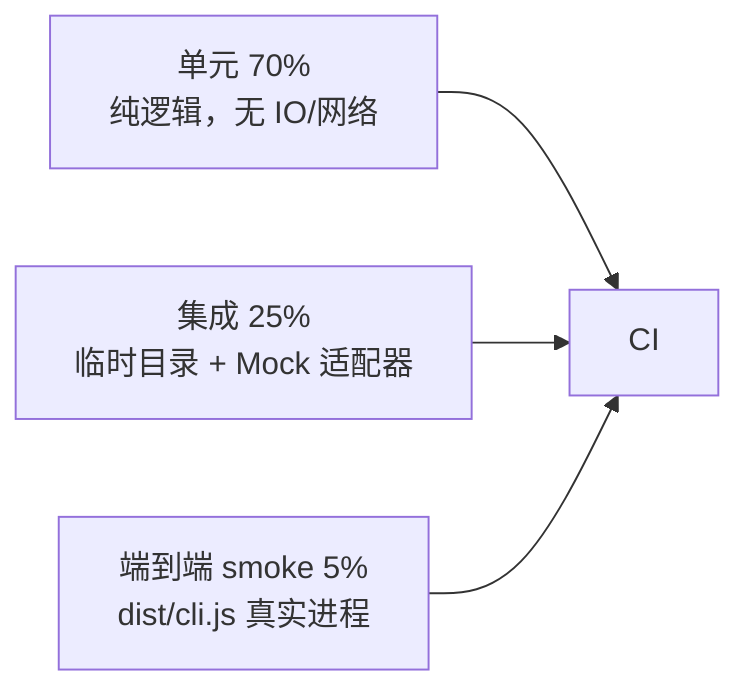

# 07 · 测试计划

> **核心约定：本地不跑构建与测试。** 验证回路是 `git push → GitHub Actions → gh 查看日志 → 按报错修复 → 再 push`，直到最近一次 run 全绿。这样能真实模拟"提交即验证"的协作方式，也让 CI 日志成为唯一的、可追溯的质量证据。

## 1. 验证回路

```text
编码（单功能）
   ↓
git add && git commit -m "feat(...): ..."
   ↓
git push origin main
   ↓
gh run list --branch main -L 1            # 拿 run id
gh run watch <id>                         # 等结束
   ├─ success  → 进入下一个功能
   └─ failure  → gh run view <id> --log-failed
                     ↓ 读报错（TS 类型错 / 断言失败 / smoke 非零退出）
                  修代码 → fix(...) 提交 → push → 重复
```

每次 push 都必须至少确认一次 CI 结果；不允许"先攒几个功能再说"。修复一律用新的 `fix(...)` 提交，不改写历史。

## 2. CI 流水线

`.github/workflows/ci.yml`：

| 步骤 | 命令 | 失败含义 |
| --- | --- | --- |
| checkout | `actions/checkout@v4` | — |
| setup-node | `actions/setup-node@v4`，matrix `[22, 24]`，`cache: npm` | lock 与 Node 版本不兼容 |
| install | `npm ci` | lockfile 缺失/漂移、依赖解析失败 |
| build | `npm run build` | **TS 类型错误 / 编译错误**（最常见的 CI 报错来源） |
| typecheck | `npm run typecheck` | 严格模式下的类型遗漏 |
| test | `npm test`（`node --test test/*.test.mjs`） | 单元/集成断言失败 |
| smoke | `node dist/cli.js --version` 等 | 入口/shebang/产物路径问题 |
| smoke-run | `node dist/cli.js --profile headless "hello"` | 端到端 turn 链路离线可跑 |

矩阵两个 job 并行；任一 job 失败即 run 失败。**Node 22 与 24 都要绿**，用于捕获运行时 API 差异。

## 3. 测试分层



- **单元**：配置组合、SSE 解析、投影、作用域解析、审批判定。
- **集成**：`SessionStore` 落盘往返、工具流水线、`AgentLoop` 完整 turn、`--json` 输出、Web handler。
- **E2E smoke**：真实 `node dist/cli.js` 进程（CI smoke 步骤），验证发布产物可运行。

所有测试用 `node:test` + `node:assert/strict`，import `../dist/*.js`（即**测真实构建产物**而非源码），避免"源码能过、产物不能跑"的盲区。

## 4. 用例清单

| 测试文件 | 用例 | 层 |
| --- | --- | --- |
| `smoke.test.mjs` | 版本号格式、CLI 入口模块可 import | 单元 |
| `context.test.mjs` | `provide/get/peek`；缺失服务抛 `DshError` | 单元 |
| | `onDispose` 按逆序执行；`dispose()` 幂等 | 单元 |
| | `PluginHost.unmount` 后服务/工具/监听全部清除 | 单元 |
| | EventBus `serial` 顺序；`waterfall` 改写载荷与 `next()` 委托 | 单元 |
| | 未调用 `next()` 的 waterfall 不继续 | 单元 |
| | `waitFor` 在 `provide` 后 resolve；`service/added` 通知 | 单元 |
| | scoped 影子覆盖 global；`restrict` 交集过滤 | 单元 |
| `config.test.mjs` | bundle 顺序决定行顺序 | 单元 |
| | 同 id `replace` 整体替换配置（非深合并） | 单元 |
| | 层级优先级：bundle < profile < home < `--patch` | 单元 |
| | `insert before/after`、`remove` 定位 | 单元 |
| | `--dump-config` 含用户层，`--dump-default-config` 不含 | 单元 |
| | 未知 bundle / 未知 `use` / 重复 id 报 `CFG_*` 且带 hint | 单元 |
| | 7 个 bundle + 6 个 profile 模板自洽 | 单元 |
| `session.test.mjs` | append 后 `seq` 单调、`ts` 有序 | 集成 |
| | JSONL 写后重开，事件一致 | 集成 |
| | 被截断尾行被忽略且可继续 append | 集成 |
| | `deriveMessages` 映射 system/user/assistant/tool 与 tool_calls | 单元 |
| | `assistant/attempt` 不进入模型历史 | 单元 |
| | `fork(atSeq)` 复制边界前事件、生成新代际文件 | 集成 |
| | `resume` 续写已有会话 | 集成 |
| | `search` 命中与不命中 | 集成 |
| | `stat/list` 只读 header、不解析事件 | 集成 |
| `llm.test.mjs` | SSE：`data:` 帧、`[DONE]`、空行、注释行 | 单元 |
| | 跨 chunk 半包 UTF-8 / 半行帧正确拼接 | 单元 |
| | tool_call delta 按 index 聚合出完整 name/args | 单元 |
| | DeepSeek 请求体（model/messages/tools/stream）构造正确 | 单元 |
| | 注入 fetch 返回脚本化流，端到端产出 text-delta + done | 集成 |
| | `AbortSignal` 取消透传 | 单元 |
| | 无 Key 时 `resolve()` 回退 `mock` | 单元 |
| | Mock 编排：先 tool_call、收到 tool result 后给最终回答 | 集成 |
| `tools.test.mjs` | register/list/restrict 与 scoped 影子 | 单元 |
| | `pre-execute` 可改写参数、`post-execute` 可改写输出 | 单元 |
| | 审批 `never` 拒绝高危工具、`ask` 在允许名单时放行 | 单元 |
| | 三种权限预设对 read/write/exec 的矩阵 | 单元 |
| | 超时与并发限制生效 | 集成 |
| | 未知工具 / 被 restrict 过滤工具返回一致拒绝 | 单元 |
| | `write_file` 越界路径被拒 | 单元 |
| `loop.test.mjs` | 两步 turn：tool_call → tool/result → 最终文本 | 集成 |
| | durable 事件序列完整（turn/step/message/tool 成对） | 集成 |
| | `agent/pre-step` reject → 零 step turn | 集成 |
| | `maxSteps` 截断且仍写 `turn/end` | 集成 |
| | 取消后无悬空 `tool/call`（补失败 result） | 集成 |
| | `deriveMessages` 可完整重建最后一次请求 | 集成 |
| | `--json` run 事件可被 NDJSON 解析 | 集成 |
| `cli.test.mjs` | `--version` / `--help` 输出 | E2E |
| | `--dump-config` 输出合法 JSON 且含预期行 | E2E |
| | headless 无 Key 用 Mock 输出最终文本 | E2E |
| | `--json` 输出 NDJSON，每行可 `JSON.parse` | E2E |
| | stdin(`-`) 读取任务 | E2E |
| | `--session-id` 续跑使事件数增加 | E2E |
| | `dsh plugin --profile tui list` 正常 | E2E |
| | 斜杠命令不产生 `user/message` | 集成 |
| `web.test.mjs` | `GET /api/health` 200 + 版本 | 集成 |
| | `GET /api/config` 返回组合树 | 集成 |
| | `POST /api/run` 返回可解析结果 | 集成 |
| | 未知路径 404；请求体过大 413 | 集成 |

## 5. 测试数据与隔离

- 会话与配置写入 `fs.mkdtempSync(path.join(os.tmpdir(), 'ts-dsh-'))`，每个测试用 `DSH_HOME` 指向独立临时目录，`after()` 清理。
- **不读真实 `~/.dsh`**；不依赖 `DEEPSEEK_API_KEY`（测试显式清空）。
- 网络调用全部通过 `fetch` 注入或 Mock 适配器；CI 无网络也能跑。
- `run_command` 测试只用 `execFile(process.execPath, ['-e', '...'])`，不拼 shell、不依赖 POSIX 命令。

## 6. 覆盖率目标

| 层 | 行覆盖目标 | 说明 |
| --- | --- | --- |
| `core/*` | ≥ 90% | 插件宿主是地基 |
| `config/*` | ≥ 90% | 组合语义关键 |
| `session/*` | ≥ 85% | 真相源，投影必须准 |
| `llm/sse.ts` | ≥ 90% | 流式解析边界多 |
| `tools/*` | ≥ 80% | 安全策略相关 |
| `agent/loop.ts` | ≥ 85% | 主循环不变量 |
| 整体 | ≥ 80% | 门禁基线（后续里程碑启用） |

> 当前 M0–M9 以"用例全部通过 + CI 全绿"为硬性验收；覆盖率统计作为后续门禁接入，不阻塞本次交付。

## 7. 缺陷分级与修复

| 级别 | 判据 | 处理 |
| --- | --- | --- |
| P0 | CI 编译失败 / 全部测试挂 / CLI 无法启动 | 立即停下手头功能，就地修，新 `fix` 提交并确认全绿后再继续 |
| P1 | 单个断言失败 / 某 Node 版本失败 | 同一轮修完，日志里记录失败 job 与原因 |
| P2 | 文档与实现不一致 / 措辞问题 | 收尾阶段统一修 |

修复纪律：

1. 先看 `gh run view <id> --log-failed`，**按日志报错定位**，不猜。
2. 一次修复只改导致失败的根因，不顺手重构。
3. 修完 push 后必须再看到 `success`，否则不算完成。
4. 不用 `--no-verify`、不 `reset --hard`、不 `push --force`。

## 8. 本地如何手动验证（供读者，本项目 CI 之外）

```bash
npm ci
npm run build
npm test
npm run typecheck
node dist/cli.js --profile headless "hello"
```

本项目按约定**不在本地执行以上命令**，交付质量以 GitHub Actions 日志为准。
